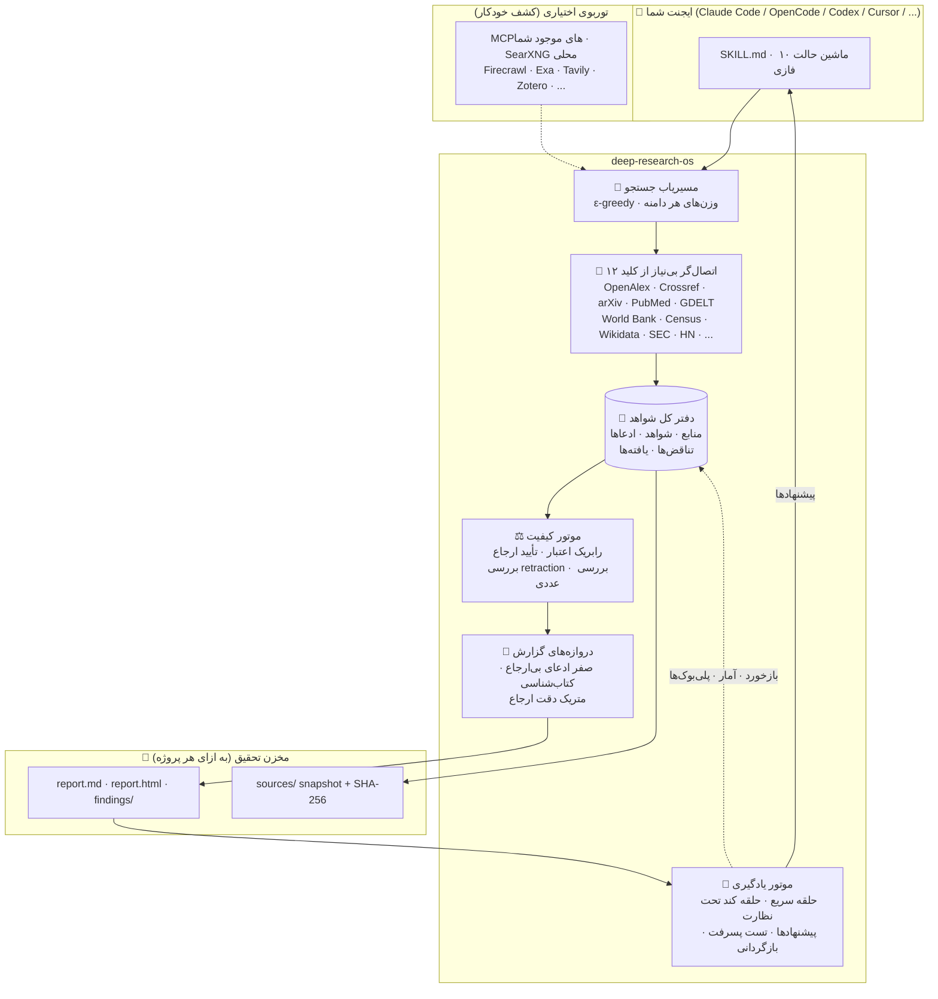

<div align="center" dir="rtl">

```
██████╗  ███████╗ ███████╗ ██████╗    ██████╗  ███████╗ ███████╗ ███████╗  █████╗  ██████╗   ██████╗ ██╗  ██╗    ██████╗  ███████╗
██╔══██╗ ██╔════╝ ██╔════╝ ██╔══██╗   ██╔══██╗ ██╔════╝ ██╔════╝ ██╔════╝ ██╔══██╗ ██╔══██╗ ██╔════╝ ██║  ██║   ██╔═══██╗ ██╔════╝
██║  ██║ █████╗   █████╗   ██████╔╝   ██████╔╝ █████╗   ███████╗ █████╗   ███████║ ██████╔╝ ██║      ███████║   ██║   ██║ ███████╗
██║  ██║ ██╔══╝   ██╔══╝   ██╔═══╝    ██╔══██╗ ██╔══╝   ╚════██║ ██╔══╝   ██╔══██║ ██╔══██╗ ██║      ██╔══██║   ██║   ██║ ╚════██║
██████╔╝ ███████╗ ███████╗ ██║        ██║  ██║ ███████╗ ███████║ ███████╗ ██║  ██║ ██║  ██║ ╚██████╗ ██║  ██║   ╚██████╔╝ ███████║
╚═════╝  ╚══════╝ ╚══════╝ ╚═╝        ╚═╝  ╚═╝ ╚══════╝ ╚══════╝ ╚══════╝ ╚═╝  ╚═╝ ╚═╝  ╚═╝  ╚═════╝ ╚═╝  ╚═╝    ╚═════╝  ╚══════╝
```

# سیستم‌عامل تحقیق عمیق (deep-research-os)

**یک سیستم‌عامل پژوهشِ خودبهبود برای ایجنت‌های هوش مصنوعی.**
دفتر کل شواهد · تأیید ارجاع · تناقض‌یابی · بدون نیاز به کلید API · یادگیری تحت نظارت انسان.

[](https://opensource.org/licenses/MIT)
[](https://www.python.org/downloads/)
[](https://agentskills.io)
[](tests/)
[](evals/)
[](https://modelcontextprotocol.io)
[](#-فهرست-منابع-رایگان-بدون-کلید)
[](CONTRIBUTING.md)

[English](README.md) · **فارسی**

</div>

---

<div dir="rtl">

## 🎯 این پروژه چیست؟

`deep-research-os` یک **[مهارت ایجنت (Agent Skill)](https://agentskills.io)** است — نه یک اپلیکیشن جدا، نه یک فهرست MCP دیگر. آن را در Claude Code، OpenCode، Codex، Cursor، Gemini CLI یا هر ایجنت دیگری که استاندارد باز `SKILL.md` را می‌فهمد نصب کنید، و ایجنت شما صاحب یک خط تولید تحقیقِ کامل و منضبط می‌شود:

> **هر ادعا یک نقل‌قول عین‌به‌عین می‌گیرد. هر نقل‌قول یک منبعِ آرشیوشده. هر منبع یک امتیاز اعتبار.
> هر تناقض آشکار می‌شود. هر گزارش از دروازه‌های کیفیت سخت عبور می‌کند.
> و خودِ مهارت — با تأیید شما — با هر اجرا باهوش‌تر می‌شود.**

با **صفر کلید API** کار می‌کند (۱۲ API رایگان تحقیقاتی درونش تعبیه شده)، به‌طور خودکار وقتی MCP سرور یا کلیدهایی که از قبل دارید را تشخیص دهد ارتقا می‌یابد، و هرگز اجازه نمی‌دهد یک وابستگی پولی، خط تولید را زمین بزند.

```text
شما:      دربارهٔ تجربه کاربری شارژ خودروی برقی در اروپا تحقیق کن، همه‌چیز ارجاع بده

ایجنت:    ✓ فاز 0   brief.md ساخته شد — سؤال به ۴ زاویه شکسته، پروفایل deep
          ✓ فاز 1   چارچوب: اصطلاحات چندزبانه، بازیگران، ۹ منبع کاندید
          ✓ فاز 2   برنامه: ۳ استراتژی کوئری مستقل برای هر زاویه، قواعد توقف
          ✓ فاز 3   ۱۴ منبع از OpenAlex + GDELT + وب (۵ مورد آرشیو شد)
          ✓ فاز 4   ۴۷ نقل‌قول عین‌به‌عین با موقعیت‌یاب (صفحه/بخش)
          ✓ فاز 5   اعتبار: ۶×A، ۵×B، ۲×C، ۱×D (علامت‌گذاری شد)
          ✓ فاز 6   ادعاها طبقه‌بندی شد · ۲ تناقض پیدا و داوری شد
          ✓ فاز 7   یافته‌ها با ضداستدلال‌ها سنتز شد
          ✓ فاز 8   گزارش ساخته شد — صفر ادعای بی‌ارجاع، دقت ارجاع ۱۰۰٪
          ✓ فاز 9   بازنگری ثبت شد · ۱ پلی‌بوک کاندید · ۱ پرسش ترجیح
```

---

## ✨ چرا این اسکیل؟

ابزارهای تحقیق عمیق در ۲۰۲۶ به سه دسته تقسیم می‌شوند و هر کدام یک خلأ دارند:
**ابزارهایی که جستجو می‌کنند** (سرورهای MCP — جزیره‌های بی‌حافظه)،
**اپ‌هایی که تحقیق می‌کنند** (GPT-Researcher و local-deep-research — جعبه‌های سیاه کنار ایجنت شما)،
و **مهارت‌هایی که خط تولید می‌سازند** (hyperresearch و academic-research-skills — زنجیره‌های خوب ولی بدون یادگیری پایدار).
`deep-research-os` هر سه را در یک مهارتِ agent-native با دفتر کل شواهد در قلبش ادغام می‌کند.

| قابلیت | deep-research-os | مهارت‌های تحقیق معمول | اپ‌های تحقیق | مجموعه‌های MCP |
| --- | :---: | :---: | :---: | :---: |
| Agent-native (SKILL.md، همه پلتفرم‌ها) | ✅ | ✅ | ❌ | ✅ |
| کار با **صفر کلید API** | ✅ | عمدتاً ❌ | عمدتاً ❌ | ❌ |
| دفتر کل شواهد مشترک بین سشن‌ها | ✅ | جزئی | فقط داخلی | ❌ |
| الزام نقل‌قول عین‌به‌عین برای هر ادعا | ✅ | نادر | برخی | ❌ |
| آرشیو snapshot (ضد لینک‌مرده) | ✅ | ❌ | ❌ | ❌ |
| تشخیص و داوری تناقض | ✅ | نادر | نادر | ❌ |
| بررسی retraction و یکپارچگی علمی | ✅ | ❌ | ❌ | ❌ |
| دروازه‌های کیفیت ماشین‌قابل‌بررسی | ✅ | جزئی | ❌ | ❌ |
| دروازه سخت «صفر ادعای بی‌ارجاع» | ✅ | نادر | ❌ | ❌ |
| **حلقه یادگیری خودبهبود تحت نظارت** | ✅ | ❌ | ❌ | ❌ |
| پرسش ترجیح (نمایش A/B به شما) | ✅ | ❌ | ❌ | ❌ |
| اسکن کشف ابزار/متد جدید | ✅ | ❌ | ❌ | ❌ |
| هارنس ارزیابی آفلاین با سناریوهای تله | ✅ | ❌ | نادر | ❌ |
| سقف بودجه + تنزل تدریجی | ✅ | جزئی | جزئی | ❌ |

## 🏗 معماری



## 🚀 شروع سریع (۶۰ ثانیه)

```bash
# ۱. کلون
git clone https://github.com/NarimanKhaleghi/deep-research-os
cd deep-research-os

# ۲. نصب خودکار روی پلتفرم ایجنت شما (Claude/OpenCode/Codex/Cursor)
./install.sh                       # یا: python scripts/install.py
#    → ساخت venv، نصب وابستگی‌ها، لینک مهارت، آماده‌سازی ~/.config/deep-research-os

# ۳. بررسی محیط (بدون هیچ کلیدی)
python scripts/research_ctl.py doctor

# ۴. اولین تحقیق — خروجی دقیقاً در پوشه‌ای که خودتان انتخاب می‌کنید
python scripts/research_ctl.py init "سؤال تحقیقاتی شما" --profile deep --dir ~/Research/your-topic
python scripts/research_ctl.py status
```

بعد فقط به ایجنت خود بگویید: *«با deep-research-os یک تحقیق عمیق دربارهٔ X انجام بده»* — جریان کار SKILL.md خودش پیش می‌رود.

**مقاصد نصب:** `./install.sh --platform claude|opencode|codex|cursor|all|generic --dest <path>` (حالت symlink با `--link` برای توسعه).

### تازه‌های نسخهٔ ۱.۲ — ابزار پژوهش

- **گزارش دوزبانه** — `report build` زبان بریف/پرسش را تشخیص می‌دهد (انگلیسی یا فارسی) یا با `--lang en|fa` اجبار می‌شود؛ سرتیترها، جدول‌ها، گیت‌ها، محدودیت‌ها و پیوست ادعا بومی‌سازی می‌شوند و چیدمان RTL واقعی دارد.
- **طراحی خودبسنده** — بازطراحی «ابزار پژوهش» هر گزارش را به یک فایل HTML آفلاین تبدیل می‌کند: توکن‌های کاغذ و جوهر، فونت‌های OFL میزبانی‌شده، پوستهٔ روشن/تیره، فهرست چسبان و چاپ A4. بدون CDN و بدون وابستگی به جاوااسکریپت.
- **پیوست ادعا** — هر ادعای `CL-` دوطرفه به منبع `SRC-` و شاهدش پیوند دارد (`#claim-CL-…` ↔ `#ref-SRC-…`).
- **سایت معرفی** — `python scripts/build_site.py` سایت دوزبانه را در `docs/` برای GitHub Pages می‌سازد: `/` و `/fa/`، hreflang متقابل، کارت‌های OG جدا، JSON-LD، sitemap، robots، `llms.txt`، ۴۰۴ و گزارش‌های نمونهٔ واقعی.
- **کیفیت سخت‌گیرانه** — ۴۹ تست و ۸ ارزیابی آفلاین؛ Lighthouse موبایل: کارایی ۹۶–۹۹، دسترس‌پذیری ۱۰۰، بهترین شیوه‌ها ۱۰۰، سئو ۱۰۰.

### تازه‌های نسخهٔ ۱.۱ — خروجی، الزامات، بازتولیدپذیری

- **تحقیق در پوشهٔ شما** — `init --dir` دقیقاً همان‌جا می‌نویسد؛ ابزار از نوشتن داخل پوشهٔ مهارت/ریپو/رانتایم خودداری می‌کند و `project move --to ~/Research/<topic>` پروژه‌های قبلی را منتقل می‌کند.
- **قرارداد الزامات** — هر قید صریح پرامپت (`requirements add`) باید به یک لنگرِ موجود در گزارش «map» شود یا با دلیل «waive»؛ `report build` تا حل‌نشدن الزامات پاس نمی‌شود و دلایل waive در بخش محدودیت‌ها چاپ می‌شوند.
- **مرور بازتولیدپذیر** — همهٔ جستجوها ژورنال می‌شوند (`searches.jsonl` با شناسهٔ `SCH-####`؛ جستجوهای دستی با `searchlog add`)؛ منابع وضعیت غربالگری و دلیل حذف دارند؛ گزارش، جدول قیف PRISMA-سبک و جدول جستجوها را می‌سازد.
- **انضباط ادعاهای هنجاری** — `claims add --kind normative` به منبع رسمی/اولیه و نقل‌قولی با زبان ممنوعیت/الزام نیاز دارد (تشخیص خودکار فارسی+انگلیسی)؛ اسناد رسمی قدیمی‌تر از ۱۸ ماه هشدار «کهنگی» می‌گیرند، نه ادعای بی‌پشتوانه.
- **کتاب‌شناسی APA-7** — `sources enrich` متادیتای معتبر را از Crossref می‌گیرد (نویسنده، نشریه، سال، صفحات، DOI نسخهٔ چاپی) و اختلاف نسخهٔ پیش‌چاپ/چاپی را علامت می‌زند؛ کتاب‌شناسی خروجی‌های آکادمیک دروازهٔ سخت دارد.
- **مدل عملیاتی** — خروجی آکادمیک باید یافته‌های `model`، `scenarios` (حداقل ۵ سناریو شامل سناریوی ترکیبی) و `sensitivity` (با نقاط شکست عددی) داشته باشد، به‌همراه «ماتریس مقایسهٔ ادبیات» از حداقل ۸ مطالعهٔ کلیدی (`references/methods/decision-modeling.md`).

## 🔁 خط تولید ۱۰ فازی

هر فاز یک سند مرجع (`references/phases/`)، یک قرارداد خروجی، و یک **دروازه «Complete when» ماشین‌قابل‌بررسی** دارد (`research_ctl.py gate --phase N`). هیچ‌چیز بر اساس حس‌وحال کامل نمی‌شود.

| فاز | خروجی | دروازه (ماشین‌قابل‌بررسی) |
| --- | --- | --- |
| ۰ دریافت | `brief.md` | سؤال شکسته‌شده · معیار موفقیت · مقطع زمانی تحقیق · پروفایل · چک نگهداری |
| ۱ چارچوب | `plan.md` §۱ | اصطلاحات + مترادف چندزبانه · بازیگران · منابع کاندید هر دامنه |
| ۲ برنامه | `plan.md` §۲ | ≥۲ استراتژی کوئری مستقل برای هر زاویه · قواعد توقف · منابع هدف |
| ۳ جمع‌آوری | `sources/SRC-*.json` + snapshot | فراداده کامل · snapshot + SHA-256 · پوشش نسبت به زوایا |
| ۴ استخراج | `evidence.jsonl` | فقط نقل‌قول عین‌به‌عین · موقعیت‌یاب · بدون بازنویسی |
| ۵ ارزیابی | امتیاز اعتبار منابع | هر منبع A–D امتیاز گرفته · retraction و تعارض منافع ثبت شده |
| ۶ تأیید | `claims.jsonl` · `verify_report.json` | هر ادعا طبقه‌بندی شده · ارجاعات تأیید شده · تناقض داوری یا ثبت شده |
| ۷ سنتز | `findings/FN-*.md` | ارجاع به شناسه ادعاها · برچسب قدرت · ضداستدلال · شکاف‌ها ثبت |
| ۸ گزارش | `report.md` / `report.html` | **صفر ادعای بی‌ارجاع** · کتاب‌شناسی کامل · اعداد سازگار |
| ۹ بازنگری | `retrospective.json` | یادگیری‌ها ثبت · کاندید پلی‌بوک ارزیابی · پرسش ترجیح در صورت نیاز |

## 🧾 دفتر کل شواهد (ایده اصلی)

هر پروژه یک **پوشه قابل حمل و قابل ممیزی** است — نه تاریخچه چت:

```text
research-os/
└── projects/ev-charging-eu/
    ├── state.json            # وضعیت اجرا، دروازه‌ها، شمارنده بودجه
    ├── brief.md · plan.md    # چارچوب و استراتژی
    ├── sources/
    │   ├── SRC-0001.json     # فراداده + اعتبار + هش snapshot
    │   └── SRC-0001.txt      # آرشیو متن (ضد لینک‌مرده)
    ├── evidence.jsonl        # نقل‌قول‌های عین‌به‌عین + موقعیت‌یاب
    ├── claims.jsonl          # چرخه حیات: unverified → supported / contradicted
    ├── contradictions.jsonl  # تناقض‌ها + سوابق داوری
    ├── findings/             # بخش‌های سنتزشده متصل به ادعاها
    ├── report.md             # خروجی دروازه‌گذاری‌شده
    └── retrospective.json    # یادگیری‌های فاز ۹
```

## 🧠 موتور یادگیری پیوسته

اسکیل **در طول اجراها خودش را بهتر می‌کند** — اما تحت یک مدل حاکمیتی سختگیرانه (هرگز بی‌صدا، هرگز ناایمن):

| کلاس تغییر | خودمختاری |
| --- | --- |
| آمار منابع (بازده و نتایج تأیید) | 🟢 خودکار |
| ثبت بازخورد (صریح + ضمنی + داوری‌ها) | 🟢 خودکار |
| تنظیم وزن مسیریابی در بازه امن (±ε) | 🟢 خودکار با لاگ اجباری |
| ساخت «پلی‌بوک کاندید» از اجرای موفق | 🟢 فقط کاندید |
| ارتقای کاندید → فعال (champion/challenger + eval) | 🔴 نیازمند **تأیید شما** + تست پسرفت |
| بازنشستگی / ادغام پلی‌بوک‌ها | 🔴 پیشنهاد با مدارک عددی → تأیید شما |
| افزودن منبع / متد / ابزار جدید از اسکن کشف | 🔴 پیشنهاد → تأیید شما |
| فازها، اسکیماها و سیاست امنیتی `SKILL.md` | ⛔ هرگز خودکار |

- **حلقه سریع (هر اجرا):** `learn retrospect` ثبت می‌کند چه کار کرد و چه نکرد، آمار Beta هر منبع را به‌روزرسانی می‌کند و کاندید پلی‌بوک می‌سازد.
- **پرسش ترجیح:** وقتی A/B واقعی وجود دارد (دو استراتژی، دو ساختار گزارش، قهرمان در برابر چلنجر)، اسکیل **دو نمونه نشان می‌دهد و می‌پرسد کدام را ترجیح می‌دهید** — حداکثر ۲ سؤال در هر اجرای deep، هرگز وسط کار. اگر ۳ بار سؤالی را رد کنید، آن تریگر خودش خاموش می‌شود.
- **حلقه کند (هر N اجرا / ماهانه / دستی):** `learn maintain` ادغام، بازنشستگی و ارتقا پیشنهاد می‌دهد. `learn scan-upstream` خودش GitHub، arXiv و مارکت‌پلیس‌ها را برای **ابزارها و متدهای جدیدی که می‌توانند قابلیت تحقیق عمیقش را ارتقا دهند** جستجو می‌کند و گزارش کشف قابل‌بازبینی می‌سازد.
- **ریل‌های امنیتی:** هر تغییر تأییدشده اول با مجموعه ارزیابی آفلاین تست پسرفت می‌خورد — پسرفت خودکار بازگردانی می‌شود. `learn explain <item>` نشان می‌دهد چرا هر وزنی جابه‌جا شد (با مدارک). `learn revert <id>` هر چیزی را برمی‌گرداند. و `learn mode auto|advisory|off` کلید خاموش است.
- **یادگیری منابع:** جدول‌های تمایل هر دامنه یاد می‌گیرند *«برای موضوعات آکادمیک، اولویت اول OpenAlex + Crossref است — ولی همیشه ۱۵٪ ظرفیت برای اکتشاف در همه منابع باز می‌ماند»* (کف ε-greedy؛ هرگز تونل نمی‌زند و هرگز کشف را متوقف نمی‌کند).

پروتکل کامل حاکمیت: [`references/learning-protocol.md`](references/learning-protocol.md)

## 🔌 فهرست منابع رایگان (بدون کلید)

همه از پیش تعبیه‌شده. بدون کلید، بدون ثبت‌نام. آداب polite-pool درونشان رعایت شده.

| اتصال‌گر | دامنه | توضیح |
| --- | --- | --- |
| **OpenAlex** | آکادمیک | ۲۴۰M+ اثر، گراف ارجاع، پرچم retraction |
| **Crossref** | آکادمیک | فراداده DOI، روابط update-to (retraction) |
| **arXiv** | پیش‌چاپ | Atom API، جستجوی دسته‌ای |
| **PubMed (E-utilities)** | پزشکی | esearch + efetch |
| **Unpaywall** | دسترسی آزاد | DOI → لینک PDF قانونی OA |
| **GDELT** | اخبار / رویدادهای جهانی | Doc API 2.0، لحن و جغرافیا |
| **World Bank** | اقتصاد | سری‌های زمانی شاخص‌ها، ۲۰۰+ اقتصاد |
| **Data Commons** | آمار | مشاهدات گراف دانش (کلید اختیاری) |
| **US Census** | جمعیت‌شناسی | API آمار رسمی |
| **Wikidata** | موجودیت‌ها | پرس‌وجوی ساختاریافته (+SPARQL) |
| **SEC EDGAR** | اسناد مالی | جستجوی تمام‌متن، پرونده شرکت‌ها |
| **Hacker News** | نبض فناوری | جستجوی Algolia (بحث‌ها و معرفی‌ها) |
| **Web fetch** | همه‌چیز | استخراج readability (trafilatura) |
| **PDF extract** | مقالات و گزارش‌ها | نردبان PyMuPDF → pdftotext → pypdf |

توربوی اختیاری (اگر وجود داشته باشد خودکار کشف می‌شود؛ کانفیگ آماده دارد):
Firecrawl · Exa · Tavily · Brave · Perplexity · Apify · Bright Data · Zotero · Jupyter · Docling · Dialog Reddit.
جزئیات: [`references/integrations/mcp-catalog.md`](references/integrations/mcp-catalog.md)

## 🛡 امنیت و یکپارچگی

- **دفاع در برابر prompt injection:** محتوای واکشی‌شده «داده» است، هرگز «دستور» — هم در پروتکل اجرا می‌شود و هم در SKILL.md تصریح شده.
- **تأیید ارجاع:** resolve کردن DOI + تطبیق فازی عنوان (rapidfuzz) + بررسی زنده بودن URL + پشتیبان Wayback؛ متریک *دقت ارجاع* به‌سبک FACT در هر اجرا.
- **آگاهی از retraction:** پرچم‌های `is_retracted` (OpenAlex) و `update-to` (Crossref) وارد امتیاز اعتبار می‌شوند؛ ادعاهای متکی به مقاله سلب‌شده دوباره درجه‌بندی می‌شوند.
- **سازگاری عددی:** اعداد داخل ادعاها با نقل‌قول‌هایشان چک می‌شوند (با دقت کامل — `96.555% ≠ 97%`).
- **ماندگاری منبع:** هر منبع با SHA-256 به‌صورت محلی آرشیو می‌شود — گزارش شما حتی اگر وب تغییر کند قابل ممیزی می‌ماند.

## 🧪 ارزیابی — اثبات کارکرد

دو هارنس، هم‌راستا با بهترین متدولوژی روز (رابریک وزنی به‌سبک RACE، دقت ارجاع به‌سبک FACT و چهار بُعد DRACO: دقت · کامل‌بودن · بی‌طرفی · کیفیت ارجاع):

```bash
python evals/run_evals.py --offline   # آماده CI، مبتنی بر fixture، بدون شبکه
python evals/run_evals.py --live      # منابع واقعی، کوئری واقعی
```

هشت سناریو با **تله‌های کاشته‌شده** — ارجاع جعلی DOI، تناقض کاشته‌شده، انحراف خاموش اعداد، اتاق پژواک تک‌منبعی، پوشش چندزبانه (فارسی)، تست انضباط بودجهٔ پروفایل quick، پوشش الزامات و ادعای هنجاریِ بیش‌ازحد.

## 🤝 مشارکت · 📄 لایسنس

از مشارکت استقبال می‌کنیم — [CONTRIBUTING.md](CONTRIBUTING.md). قواعد طراحی سختگیرانه‌اند (شواهد-اول، بدون-کلید-به‌صورت-پیش‌فرض، یادگیری-تحت-نظارت).

MIT © مشارکت‌کنندگان deep-research-os — [LICENSE](LICENSE)

با ایستادن روی شانه‌های غول‌ها: استاندارد [Agent Skills](https://agentskills.io) ·
[DeepResearch Bench](https://deepresearch-bench.github.io/) (RACE/FACT) ·
[DRACO](https://arxiv.org/abs/2602.11685) · جامعه APIهای رایگان.

<div align="center">

**اگر این اسکیل تحقیقات شما را بهتر کرد، به مخزن ستاره بدهید — این‌طور پژوهشگر بعدی پیدایش می‌کند.** ⭐

</div>

</div>
