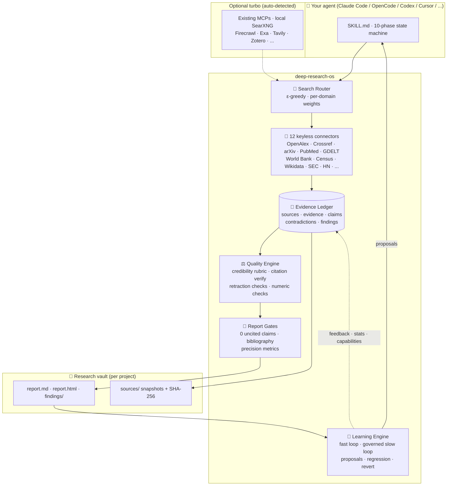
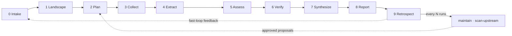
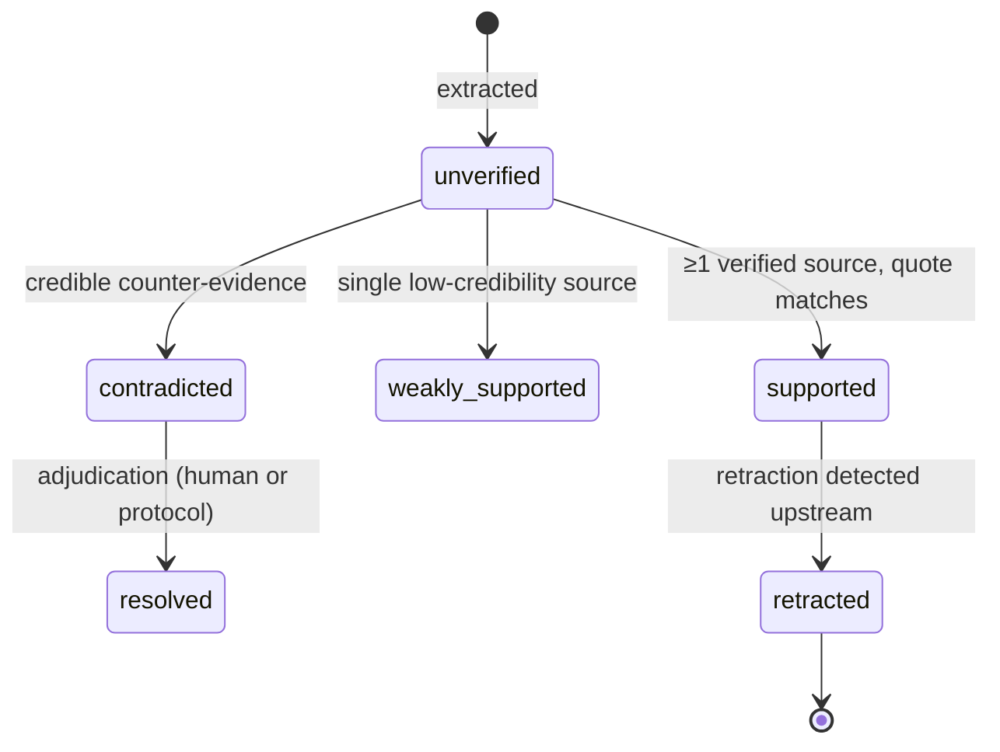

<div align="center">

```
██████╗  ███████╗ ███████╗ ██████╗    ██████╗  ███████╗ ███████╗ ███████╗  █████╗  ██████╗   ██████╗ ██╗  ██╗    ██████╗  ███████╗
██╔══██╗ ██╔════╝ ██╔════╝ ██╔══██╗   ██╔══██╗ ██╔════╝ ██╔════╝ ██╔════╝ ██╔══██╗ ██╔══██╗ ██╔════╝ ██║  ██║   ██╔═══██╗ ██╔════╝
██║  ██║ █████╗   █████╗   ██████╔╝   ██████╔╝ █████╗   ███████╗ █████╗   ███████║ ██████╔╝ ██║      ███████║   ██║   ██║ ███████╗
██║  ██║ ██╔══╝   ██╔══╝   ██╔═══╝    ██╔══██╗ ██╔══╝   ╚════██║ ██╔══╝   ██╔══██║ ██╔══██╗ ██║      ██╔══██║   ██║   ██║ ╚════██║
██████╔╝ ███████╗ ███████╗ ██║        ██║  ██║ ███████╗ ███████║ ███████╗ ██║  ██║ ██║  ██║ ╚██████╗ ██║  ██║   ╚██████╔╝ ███████║
╚═════╝  ╚══════╝ ╚══════╝ ╚═╝        ╚═╝  ╚═╝ ╚══════╝ ╚══════╝ ╚══════╝ ╚═╝  ╚═╝ ╚═╝  ╚═╝  ╚═════╝ ╚═╝  ╚═╝    ╚═════╝  ╚══════╝
```

# deep-research-os

**A self-improving research operating system for AI agents.**
Evidence-ledgered · citation-verified · contradiction-aware · keyless-first · human-governed learning.

[](https://opensource.org/licenses/MIT)
[](https://www.python.org/downloads/)
[](https://agentskills.io)
[](tests/)
[](evals/)
[](https://modelcontextprotocol.io)
[](#-keyless-source-catalog)
[](CONTRIBUTING.md)

**English** · [فارسی](README.fa.md)

</div>

---

## 🎯 What is this?

`deep-research-os` is a **[Agent Skill](https://agentskills.io)** — not another app, not another
MCP catalog. Drop it into Claude Code, OpenCode, Codex, Cursor, Gemini CLI or any
agent that speaks the open `SKILL.md` standard, and your agent gains a complete,
disciplined research pipeline:

> **Every claim gets a verbatim quote. Every quote gets a snapshot-backed source.
> Every source gets a credibility score. Every contradiction gets surfaced.
> Every report passes hard quality gates. And the skill itself gets smarter —
> with your approval — with every run.**

It works with **zero API keys** (12 free public research APIs are built in),
automatically upgrades itself when it detects MCP servers or keys you already
have, and never lets a paid dependency block the pipeline.

```text
You:      research the UX pain points of EV charging in the EU, cite everything

Agent:    ✓ phase 0  brief.md built — question decomposed, 4 angles, deep profile
          ✓ phase 1  landscape: terminology, actors, 9 candidate sources mapped
          ✓ phase 2  plan: 3 query strategies per angle, stop rules defined
          ✓ phase 3  14 sources collected from OpenAlex + GDELT + web (5 snapshotted)
          ✓ phase 4  47 verbatim evidence quotes extracted with locators
          ✓ phase 5  credibility scored: 6×A, 5×B, 2×C, 1×D (flagged)
          ✓ phase 6  claims classified · 2 contradictions found & adjudicated
          ✓ phase 7  findings synthesized with counterpoints
          ✓ phase 8  report built — 0 uncited claims, citation precision 100%
          ✓ phase 9  retrospect journaled · 1 capability candidate · 1 pref question
```

---

## ✨ Why this exists — and what makes it different

Deep-research tooling in 2026 splits into three families, and each leaves a hole:
**tools that search** (MCP servers — stateless islands), **apps that research**
(GPT-Researcher, local-deep-research — black boxes next to your agent), and
**skills that pipeline** (hyperresearch, academic-research-skills — great chains,
no persistent governed learning). `deep-research-os` fuses all three into one
agent-native skill with an evidence ledger at the core.

| Capability | deep-research-os | Typical deep-research skills | Deep-research apps | MCP collections |
| --- | :---: | :---: | :---: | :---: |
| Agent-native (SKILL.md, any platform) | ✅ | ✅ | ❌ | ✅ |
| Works with **zero API keys** | ✅ | ❌ mostly | ❌ mostly | ❌ |
| Shared evidence ledger across sessions | ✅ | partial | internal only | ❌ |
| Verbatim-quote enforcement per claim | ✅ | rare | some | ❌ |
| Snapshot archiving (link-rot proof) | ✅ | ❌ | ❌ | ❌ |
| Contradiction detection & adjudication | ✅ | rare | rare | ❌ |
| Retraction / integrity checks | ✅ | ❌ | ❌ | ❌ |
| Machine-checkable quality gates | ✅ | partial | ❌ | ❌ |
| Hard "no uncited claims" report gate | ✅ | rare | ❌ | ❌ |
| **Governed self-improving learning loop** | ✅ | ❌ | ❌ | ❌ |
| Preference elicitation (A/B with you) | ✅ | ❌ | ❌ | ❌ |
| Upstream discovery scans (new tools/methods) | ✅ | ❌ | ❌ | ❌ |
| Offline eval harness with trap scenarios | ✅ | ❌ | rare | ❌ |
| Budget ceilings + graceful degradation | ✅ | partial | partial | ❌ |

---

## 🏗 Architecture



---

## 🚀 Quickstart (60 seconds)

```bash
# 1. Clone
git clone https://github.com/NarimanKhaleghi/deep-research-os
cd deep-research-os

# 2. Install into your agent platform (auto-detects Claude/OpenCode/Codex/Cursor)
./install.sh                       # or: python scripts/install.py
#    → creates a venv, installs deps, links the skill, seeds ~/.config/deep-research-os

# 3. Verify the environment (no keys needed)
python scripts/research_ctl.py doctor

# 4. First research run — outputs go in a folder YOU choose
python scripts/research_ctl.py init "Your research question" --profile deep --dir ~/Research/your-topic
python scripts/research_ctl.py status
```

Then just talk to your agent: *"run a deep research on X using deep-research-os"* —
the SKILL.md workflow takes over.

**Platform targets:** `./install.sh --platform claude|opencode|codex|cursor|all|generic --dest <path>`
(symlink mode with `--link` for development).

### New in 1.3 — the rigor pack

- **Reproducible model cards** — decision models ship `model.json`: sourced or
  labelled assumptions, safe arithmetic equations, complete case inputs, exact
  recomputation, baseline, comparator dimensions and sensitivity breakpoints.
  `report build` fails on missing cards, hidden inputs, or arithmetic drift.
- **Honest model scope** — `structure`, `implemented_stages`, `learning` and
  `selection` are declared; single-stage, no-learning and heuristic models get
  automatic Limitations instead of being described as staged portfolio
  optimization.
- **Full-text evidence depth** — sources record `read_depth`; key studies must
  be `full-text` for academic and decision-framework reports, and critical claims
  cannot rest only on abstracts.
- **Numeric provenance** — every numeric claim needs a dated source and locator;
  regulatory claims need a document/effective date. The report renders a
  provenance table, and numeric table rows cannot bypass citation checks.
- **Fair comparator audit** — comparators are scored on cost of delay, staging
  and learning, with a note explaining every missing capability and a required
  statement of where the model actually differs (no WSJF strawman).
- **Harder QA** — 53 tests, 8 offline evals; Lighthouse mobile: performance
  96–99, accessibility 100, best practices 100, SEO 100.

### New in 1.2 — the research instrument

- **Bilingual reports** — `report build` follows the brief/question language
  (English or Persian), or takes `--lang en|fa`; headings, tables, gates,
  limitations and the claim appendix are localized, with a true RTL layout.
- **Self-contained design** — the “research instrument” redesign ships one
  offline HTML file per report: paper/ink tokens, self-hosted OFL subset fonts,
  light/dark themes, sticky TOC, and A4 print. No CDN, no JS dependency.
- **Claim appendix** — every `CL-` claim links both ways to its `SRC-` reference
  and exhibit (`#claim-CL-…` ↔ `#ref-SRC-…`).
- **Landing site** — `python scripts/build_site.py` renders the bilingual site
  into `docs/` for GitHub Pages: `/` + `/fa/`, reciprocal hreflang, per-language
  OG cards, JSON-LD, sitemap, robots, `llms.txt`, 404 and real sample reports.
- **Harder QA** — 49 tests, 8 offline evals; Lighthouse mobile: performance
  96–99, accessibility 100, best practices 100, SEO 100.

### New in 1.1 — outputs, requirements, reproducibility

- **Research lives in your folder** — `init --dir` writes exactly where you say;
  the tool refuses to put projects inside the skill/repo/runtime directories, and
  `project move --to ~/Research/<topic>` relocates existing runs.
- **Requirements contract** — every explicit prompt constraint
  (`requirements add`) must be mapped to a report anchor or waived with a reason;
  `report build` fails on unmet requirements, and waivers are printed in
  Limitations. Academic deliverables require recorded requirements.
- **Reproducible reviews** — every search is journaled (`searches.jsonl`,
  `SCH-####`, manual searches via `searchlog add`); sources carry screening
  statuses with exclusion reasons; reports render a PRISMA-lite funnel plus a
  search-log table.
- **Normative-claim discipline** — `claims add --kind normative` requires an
  official/primary source and a quote that actually says what is
  prohibited/required (EN+FA modality check); official documents >18 months old
  raise staleness warnings instead of silent overclaims.
- **APA-7 bibliography** — `sources enrich` pulls canonical metadata from
  Crossref (authors, venue, year, pages, published DOI) and flags
  preprint/published DOI spread; academic bibliographies are hard-gated on
  completeness.
- **Operational models** — academic deliverables must ship `model`, `scenarios`
  (≥5 incl. a combination scenario) and `sensitivity` findings plus a validated
  `model.json`, and a Literature Comparison Matrix built from ≥8 reviewed key
  studies (`references/methods/decision-modeling.md`).

---

## 🔁 The 10-phase pipeline



Each phase ships with a reference doc (`references/phases/`), an artifact
contract, and a machine-checkable **Complete-when gate**
(`research_ctl.py gate --phase N`). No vibes-based completion.

| Phase | Artifact | Gate (machine-checked) |
| --- | --- | --- |
| 0 Intake | `brief.md` | question decomposed · deliverable & success criteria · research cutoff · profile · maintenance-due checked |
| 1 Landscape | `plan.md` §1 | terminology + multilingual synonyms · actors · candidate sources per domain |
| 2 Plan | `plan.md` §2 | ≥2 independent query strategies per angle · stop rules · target sources |
| 3 Collect | `sources/SRC-*.json` + snapshots | metadata complete · snapshot + SHA-256 · coverage vs angles |
| 4 Extract | `evidence.jsonl` | verbatim quotes only · locators present · no paraphrase |
| 5 Assess | credibility scores | every source scored A–D · retraction & COI recorded |
| 6 Verify | `claims.jsonl` · `verify_report.json` | every claim classified · citations verified · contradictions adjudicated or logged |
| 7 Synthesize | `findings/FN-*.md` | claim IDs referenced · strength labeled · counterpoints attached · gaps logged |
| 8 Report | `report.md` / `report.html` | **zero uncited claims** · bibliography complete · numbers consistent |
| 9 Retrospect | `retrospective.json` | learnings journaled · capability candidate evaluated · preference question if triggered |

---

## 🧾 The Evidence Ledger (the core idea)

Every project is a **portable, auditable folder** — not chat history:

```text
research-os/
└── projects/ev-charging-eu/
    ├── state.json            # run state, phase gates, budget counters
    ├── brief.md · plan.md    # scoping & strategy
    ├── sources/
    │   ├── SRC-0001.json     # metadata + credibility + snapshot hash
    │   └── SRC-0001.txt      # archived snapshot (link-rot proof)
    ├── evidence.jsonl        # verbatim quotes + locators
    ├── claims.jsonl          # lifecycle: unverified → supported / contradicted
    ├── contradictions.jsonl  # conflicts + adjudication records
    ├── findings/             # synthesized, claim-linked sections
    ├── report.md             # gated output
    └── retrospective.json    # phase-9 learnings
```

Claim lifecycle:



---

## 🧠 The Continuous Learning Engine

The skill **improves itself across runs** — under a strict human-governed model
(never silently, never unsafely):

| Change class | Autonomy |
| --- | --- |
| Source statistics, yield & verification outcomes | 🟢 automatic |
| Feedback journaling (explicit + implicit + adjudication signals) | 🟢 automatic |
| Routing weight nudges within safe bounds (±ε) | 🟢 automatic, logged |
| Capability *candidates* created from successful runs | 🟢 automatic |
| Promote candidate → active (champion/challenger on eval) | 🔴 requires **your approval** + regression test |
| Retire / merge capabilities | 🔴 proposal with numeric evidence → your approval |
| Add new source / method / tool from discovery scans | 🔴 proposal → your approval |
| `SKILL.md` phases, schemas, safety policy | ⛔ never auto-modified |

- **Fast loop (per run):** `learn retrospect` journals what worked, updates
  per-source Beta-smoothed stats, creates capability candidates.
- **Preference elicitation:** when a real A/B exists (two strategies, two report
  structures, champion vs challenger), the skill shows you **two samples and
  asks which you prefer** — max 2 questions per deep run, never mid-task. Your
  answer updates preferences; three ignored asks and that trigger self-disables.
- **Slow loop (every N runs / monthly / on demand):** `learn maintain` proposes
  merges, retirements, promotions. `learn scan-upstream` self-researches GitHub,
  arXiv and skill marketplaces for **new tools and methods that could upgrade
  its own deep-research capability**, and writes a reviewable discovery report.
- **Safety rails:** every approved change runs the offline eval regression suite
  first — a regression auto-reverts. `learn explain <item>` shows why any weight
  moved (with evidence). `learn revert <id>` undoes anything.
  `learn mode auto|advisory|off` is the kill switch.
- **Source learning:** per-domain affinity tables learn *"for academic topics,
  OpenAlex + Crossref-first works best — but always keep 15% exploration across
  all sources"* (ε-greedy floor; never tunnel-visions, never stops discovering).

Read the full governance model: [`references/learning-protocol.md`](references/learning-protocol.md).

---

## 🔌 Keyless source catalog

All built-in. No keys, no signup. Polite-pool etiquette built in.

| Connector | Domain | Endpoint flavour |
| --- | --- | --- |
| **OpenAlex** | academic | 240M+ works, citation graph, retraction flags |
| **Crossref** | academic | DOI metadata, update-to (retraction) relations |
| **arXiv** | academic (preprints) | Atom API, category search |
| **PubMed (E-utilities)** | biomedical | esearch + efetch |
| **Unpaywall** | OA availability | DOI → legal OA PDF links |
| **GDELT** | news / global events | 2.0 Doc API, tone & geography |
| **World Bank** | economics | indicator time series, 200+ economies |
| **Data Commons** | statistics | knowledge-graph observations (key optional) |
| **US Census** | demographics | official statistics API |
| **Wikidata** | entities | structured entity/knowledge queries (+SPARQL) |
| **SEC EDGAR** | filings | full-text search, company submissions |
| **Hacker News** | tech pulse | Algolia search (discussions & launches) |
| **Web fetch** | everything | readability extraction (trafilatura) |
| **PDF extract** | papers & reports | PyMuPDF → pdftotext → pypdf ladder |

Optional turbo (auto-detected if present, ready-to-paste configs included):
Firecrawl · Exa · Tavily · Brave Search · Perplexity · Apify · Bright Data ·
Zotero · Jupyter · Docling · Dialog Reddit Research.
See [`references/integrations/mcp-catalog.md`](references/integrations/mcp-catalog.md).

---

## 🛡 Safety & integrity

- **Prompt-injection defense:** fetched content is data, never instructions —
  enforced in the protocol and stated in SKILL.md.
- **Citation verification:** DOI resolution + fuzzy title matching (rapidfuzz) +
  URL liveness + Wayback fallback; FACT-style *citation precision* reported per run.
- **Retraction awareness:** `is_retracted` (OpenAlex) and `update-to` (Crossref)
  flags flow into the credibility score; retracted claims are re-graded.
- **Numeric consistency:** numbers in claims are checked against their quotes
  (precision-aware, `96.555% ≠ 97%`).
- **Source permanence:** every source is snapshotted locally with SHA-256 — your
  report stays auditable even if the web changes.

---

## 🧪 Evals — how we prove it works

Two harnesses, both aligned with the field's best methodology
(RACE-style weighted rubrics, FACT-style citation precision, DRACO's four
dimensions: accuracy · completeness · objectivity · citation quality):

```bash
python evals/run_evals.py --offline   # CI-ready, fixture-driven, network-free
python evals/run_evals.py --live      # real sources, real queries
```

Eight scenario suites with **planted traps** — fake DOI citations, planted
contradictions, silent number drift, single-origin echo chambers, multilingual
(Persian) coverage, a quick-profile budget-discipline test, requirement
coverage, and normative-claim overreach.
Methodology: [`evals/rubrics.md`](evals/rubrics.md).

---

## 🗂 Repository layout

```text
deep-research-os/
├── SKILL.md                    # agent entry point (lean, routing-first)
├── install.sh · install.py     # one-command multi-platform installer
├── scripts/
│   ├── research_ctl.py         # main CLI (init/status/gate/search/verify/report/learn)
│   ├── doctor.py               # environment + capability discovery
│   ├── lib/                    # http (retries/async), paths, utils
│   ├── connectors/             # 12 keyless connectors + router (ε-greedy)
│   ├── core/                   # ledger · claims · credibility · contradictions
│   │                           # verify · extract · snapshot · budget · reports
│   └── learning/               # feedback · stats · preferences · proposals
│                               # maintain · upstream scans
├── references/                 # protocol · phases/ · methods/ · sources/
│   │                           # quality/ · schemas/ · integrations/
│   └── learning-protocol.md    # the governance contract
├── learnings/                  # seeded registry, watchlist, capability templates
├── templates/                  # report (md/html), brief, digests, cards (jinja2)
├── assets/fonts/               # self-hosted OFL WOFF2 subsets (reports + site)
├── site/                       # landing source: content/templates/assets
├── docs/                       # generated GitHub Pages site (committed)
├── evals/                      # scenarios · fixtures · runner · rubrics
├── tests/                      # pytest suite
└── examples/                   # a real, complete sample run
```

---

## 🗺 Roadmap

- [ ] Semantic Scholar & OpenCitations connectors; connector plugin API
- [ ] `v1.3` — local embedding backend (optional) for preference similarity
- [ ] `v1.4` — GitHub App mode for org-wide vaults; per-team learning profiles
- [ ] `v2.0` — multimodal evidence (charts/tables extraction with source anchoring)

---

## 🤝 Contributing · 📄 License · 🙏 Acknowledgments

Contributions welcome — see [CONTRIBUTING.md](CONTRIBUTING.md). Design rules are
strict (evidence-first, keyless-default, governed learning); start there.

MIT © deep-research-os contributors — see [LICENSE](LICENSE).

Standing on the shoulders of: the [Agent Skills](https://agentskills.io) standard ·
[DeepResearch Bench](https://deepresearch-bench.github.io/) (RACE/FACT) ·
[DRACO](https://arxiv.org/abs/2602.11685) · the keyless-API community
(OpenAlex, Crossref, GDELT, …) · and every awesome-list maintainer who mapped
this ecosystem before us.

<div align="center">

**If this skill made your research better, star the repo — it is how the next researcher finds it.** ⭐

</div>
